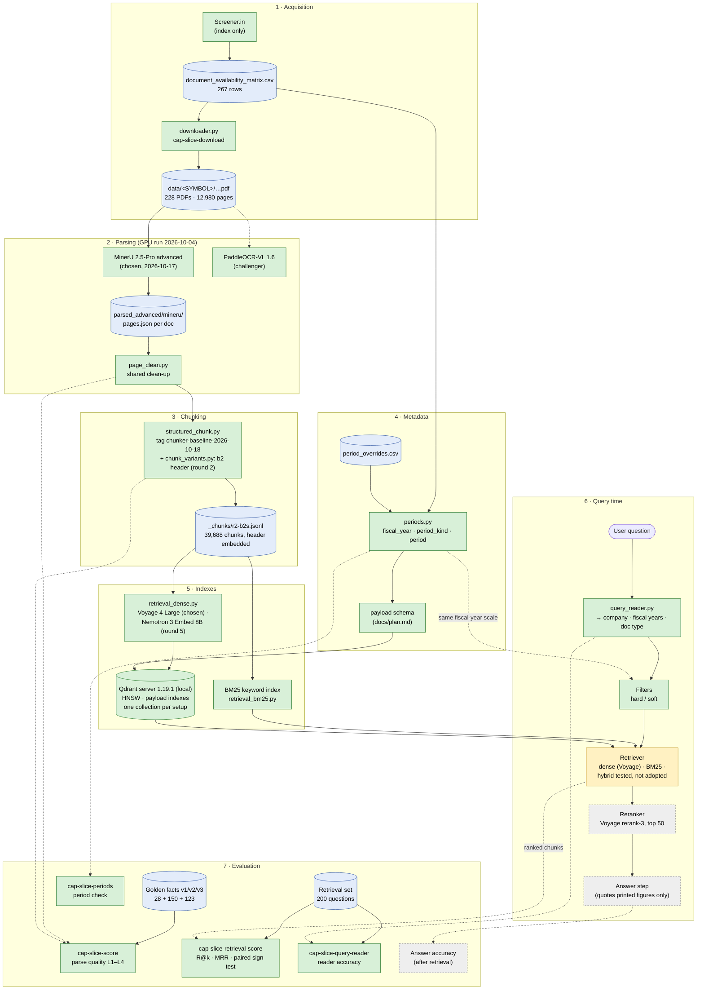

# Architecture

How the pieces fit together, and the state of each. **Update this page whenever a component is added,
replaced or changes status** (and say so in `PROGRESS.md`). The diagram is Mermaid: GitHub renders it, and
it is edited as text.

**Last updated:** 2026-11-24 (round 2: b2 context header; round 4: rerank-3 top 50; images after the answer step)

Legend: green = built and checked · yellow = next · grey dashed = planned · blue = data.
Solid arrows = data flow; dotted arrows = what each evaluation tool reads.

## Components

| # | Component | Code / data | Status | Notes |
|---|---|---|---|---|
| 1 | Catalogue | `data/document_availability_matrix.csv` | done | Discovery via Screener.in; archive URLs recorded, not Screener |
| 1 | Downloader | `downloader.py` (`cap-slice-download`) | done | Sequential, throttled; unpacks NSE ZIPs |
| 2 | Parser | MinerU 2.5-Pro advanced → `parsed_advanced/` | done | Chosen 2026-10-17 (`docs/parser-decision-2026-10-17.md`); Paddle kept as challenger |
| 2 | Clean-up | `page_clean.py` | done | Same for every parser; held fixed in the experiments |
| 3 | Chunker | `structured_chunk.py`, tag `chunker-baseline-2026-10-18`; round-2 variants in `chunk_variants.py` (`cap-slice-chunk-variants`) | done | **Round 2 (2026-11-24): b2 adopted** — context header + statement scope + heading path embedded, chunk text returned unchanged. **S22 (2026-11-25): concall transcripts chunked as turns** (`transcript=True`) → corpus `parsed_advanced/_chunks/r2-b2s.jsonl` |
| 4 | Period normaliser | `periods.py`, `data/period_overrides.csv` | done | Label / event-month rule / checked override; `review/periods/` |
| 4 | Payload schema | `docs/plan.md` § Vector store and metadata | done | Written into every point by `retrieval_dense.py load` |
| 5 | Keyword index | `retrieval_bm25.py` | done | Baseline and the keyword half of round 4 |
| 5 | Embedders | `retrieval_dense.py` (`cap-slice-retrieval-dense count / embed / load / search`): Voyage 4 Large · Nemotron 3 Embed 8B (BF16) | done — Voyage 4 Large chosen | Round 1, both at 2048 dims; batches saved before the next request (resumable); Nemotron via a hosted endpoint, own branch |
| 5 | Vector store | Qdrant server v1.19.1 run locally (`tools/qdrant/serve.sh`), collections `r<round>__<model>-<dim>__<chunker>` | done | HNSW m 16 / ef_construct 128; payload indexes on the filter fields; exact search as a check |
| 6 | Question reader | `query_reader.py` | done | Rules only; an LLM reader is a possible later comparison |
| 6 | Filters | `--filter` / `--soft` in `retrieval_bm25.py` | done | No filter · company · question-based (± next year) · answer key (upper bound) |
| 6 | Hybrid search | `retrieval_hybrid.py` (`cap-slice-retrieval-hybrid`, RRF / DBSF) | tested, not adopted | 2026-10-19: worse than dense alone (0.77 vs 0.81 R@10); `review/retrieval/hybrid/` |
| 6 | Query expansion | `query_expand.py` (`cap-slice-query-expand plan / questions / merge`), Claude Sonnet 5.5 | provisional | 2026-11-25: sub-queries for multi-fact questions, round-robin merge; multi-page 5 → 8 of 14 (`review/retrieval/expand/`) |
| 6 | Reranker | `retrieval_rerank.py` (`cap-slice-retrieval-rerank`), Voyage rerank-3 | done — top 50 adopted | Round 4 (2026-11-24): R@10 0.865 → 0.915; scores cached in `parsed_advanced/_rerank/`; open-weights reranker to compare later |
| 6 | Answer step | — | planned | Must not quote `generated` content as printed figures |
| 7 | Parse scorer | `score.py` / `compare_parsers.py` | done | Golden v1–v3, levels L1–L4 |
| 7 | Retrieval scorer | `retrieval_score.py` | done | Strict and lenient answer keys, per-group, paired sign test |
| 7 | Answer accuracy | — | planned | Same 200 questions, once the answer step exists |

**Legacy, not used by the experiments:** `extract.py` → `chunk.py` → `embed.py` → `vectorstore.py`
(`cap-slice-index`): PyMuPDF text, flat ~500-word chunks, `voyage-finance-2`. Nothing has been indexed
with it. The experiments use `retrieval_dense.py` instead (MinerU chunks, new models, Qdrant server).

## Current numbers (strict R@10, 200 questions)

| Filter | Keyword (BM25) | Voyage 4 Large | Nemotron 3 Embed 8B |
|---|---|---|---|
| None | 0.41 | 0.68 | 0.59 |
| Company | 0.47 | 0.69 (soft) | 0.63 |
| Question-based (company + year + doc type) | 0.66 | **0.81** (soft) | 0.76 |
| Answer key (upper bound) | 0.73 | 0.86 (soft) | 0.81 |

Details: `review/retrieval/README.md`.
