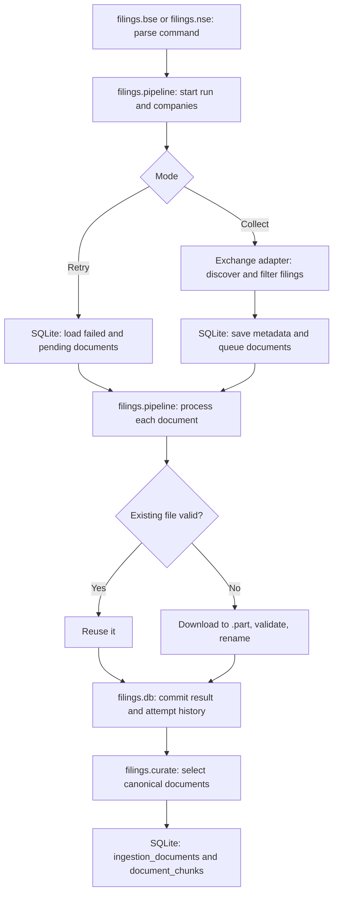

# Download pipeline: flow and file guide

Run commands from the repository root. The entry points are Python modules:

```bash
venv/bin/python -m filings.bse 500325 --years 10 --download
venv/bin/python -m filings.nse AIMTRON --years 10 --download
```

## Overall flow



NSE structured-detail tasks may also fetch and checkpoint detail JSON. A retry requested for a run with incomplete discovery repeats the relevant company's discovery before processing its queue.

## 1. Choose the exchange and discover filings

### `filings/bse.py`

This is the BSE adapter and command entry point.

- `main()` reads company codes, date range, output/database paths and retry options, then calls the shared `run_collection()` function.
- `discovery_sources()` exposes the BSE discovery steps to that shared runner.
- `collect_announcements()` pages through announcement listings and applies `classify()` before yielding matching attachment records.
- `collect_annual()` retrieves annual reports.
- `collect_shareholding()` retrieves ownership filings.
- The snapshot discovery step saves recent structured results for reference.

The adapter understands BSE field names and attachment URLs, including historical/live fallback URLs. It yields normalized document dictionaries and retains the original exchange metadata.

### `filings/nse.py`

This is the NSE Emerge/SME adapter and command entry point.

- `main()` calls the same shared runner with NSE symbols.
- `announcement_rows()` searches in 180-day windows, saves raw metadata and keeps matching announcement categories.
- `annual_rows()` gets annual reports from their dedicated endpoint.
- `shareholding_rows()` discovers full shareholding records and creates detail-fetch tasks.
- `financial_rows()` discovers legacy and integrated financial results, including available XML, HTML and PDF representations.
- `prepare_details()` fetches missing shareholding sections or legacy results JSON during queue processing. Cached sections are reused; notes attachments can become additional queued documents.

This module also creates the NSE HTTP session and validates allowed source URLs. It currently targets SME/Emerge rather than all NSE mainboard companies.

### `filings/nse_classification.py`

This small shared module decides whether an announcement's subject, description and filename indicate a required document. Both collection and curation use it.

It recognizes transcript, investor/analyst presentation, credit-rating and financial-results phrases, with special handling for meeting invitations and similar notices. It does not read PDF contents or call an LLM.

## 2. Create a run and a persistent queue

### `filings/pipeline.py` → `run_collection()`

This is the shared controller for both exchanges.

1. Open the database and recover unfinished state from a stopped writer.
2. Create a run UUID and register all requested companies.
3. For each company, call its adapter's discovery functions or load its retry queue.
4. Save each yielded filing through `Database.upsert()` and add it to `run_documents`.
5. Process queued documents sequentially.
6. Record the company outcome, run curation, and finish the run.

A company listing error is recorded separately from attachment failures. Other discovery sources/companies can continue. Metadata-only runs defer downloading.

The current implementation is one writer with sequential processing. The separation between exchange adapters and the shared runner prevents BSE and NSE from having different retry/checkpoint implementations.

## 3. Download or reuse each document

### `filings/pipeline.py` → `process_document()` and `download_file()`

For each queued document:

1. Locate its current file or calculate its destination.
2. Check that an existing file is nonempty, has the expected basic format and matches its known hash when available.
3. Prepare any required NSE detail JSON.
4. Reuse the attachment if valid; otherwise request it, using a BSE fallback URL when needed.
5. Write to a temporary `.part` file, validate the format, compute SHA-256 and atomically rename it.
6. Commit the document's state, attempt outcome and per-run outcome together.

Failed tasks retain an error and can be retried. Ctrl+C does not undo completed files. A hard stop is reconciled by the next writer; it can reuse a complete file that was renamed just before the process stopped. An incomplete file starts again from byte zero.

## 4. Store state and history

### `filings/db.py` and `filings/schema.sql`

`db.py` implements the database operations. `schema.sql` defines the tables, constraints, indexes and views.

| Table/view | What it answers |
| --- | --- |
| `collection_runs` | When did we run, with which options, and how did the run end? |
| `company_runs` | Which companies were requested, and did their discovery finish? |
| `company_run_summary` | How many tasks were downloaded, reused, failed or left pending for each company? Is retry recommended? |
| `documents` | What is each filing, where is its file, what is its latest state, and should it be ingested? |
| `run_documents` | Which document tasks belong to a run and what happened to each? |
| `download_attempts` | When was processing attempted, and what succeeded or failed? |
| `source_responses` | What did the exchange API return for a request? |
| `document_chunks` | What HTML chunks and table references have already been prepared? |
| `ingestion_documents` | Which canonical records are selected for ingestion? |

Common metadata is in SQL columns; complete input metadata and nested API data are also retained as JSON inside SQLite. Unknown metadata fields are not discarded just because they lack a dedicated column.

A process lock prevents two writer commands from changing the same queue simultaneously. SQLite WAL mode permits concurrent read-only queries.

## 5. Select documents for ingestion

### `filings/curate.py`

The shared runner calls `build()` after collection/retry. You can also run it offline:

```bash
venv/bin/python -m filings.curate
```

- `curated_rows()` checks source availability and document category, applies optional reviewed metadata, selects revisions/representations and removes exact-content duplicates.
- `save_curation()` writes `selected_to_ingest`, `selection_reason` and canonical/curated metadata back to the document records in one transaction.
- The existing `FilingHTML`/`html_chunks()` helpers generate HTML/iXBRL table/narrative chunks and store them in `document_chunks`.

Curation uses local files and database records. It does not fetch documents from the exchanges.

The handoff to the next stage is `ingestion_documents`, not every row or downloaded file. PDFs still need parsing and chunking; only the existing HTML handling is implemented so far.

## Supporting files: when are they used?

| File/folder | Role | Called by normal collection? |
| --- | --- | --- |
| `filings/status.py` | Read-only run history and failure reports | No; run when you want to inspect progress |
| `tests/test_pipeline.py` | Check retries, interruptions, persistence, metadata preservation and curation using temporary files/fake HTTP | No |
| `tests/test_nse_filtering.py` | Check category selection and automatic acceptance of new matching NSE filings | No |
| `config/nse_verified_announcements.json` | Optional existing content-review overrides, applied only to matching file hashes | Read by curation if present |
| `requirements.txt` | Pinned direct dependencies for setting up the environment | Used at installation |
| `AGENTS.md` / `progress.md` | Project rules and session handoff | Documentation |

Migration code stays available for reproducibility and its regression tests. Status reporting stays available because run history is useful during normal operation. Tests stay in Git to protect retry/checkpoint behavior as parsing work is added.

## Normal commands

```bash
# Collect and automatically curate
venv/bin/python -m filings.bse 500325 --download
venv/bin/python -m filings.nse AIMTRON --download

# Inspect history and one run's company counts
venv/bin/python -m filings.status
venv/bin/python -m filings.status --run RUN_UUID

# Retry known failed/pending documents
venv/bin/python -m filings.nse AIMTRON --retry-failed

# Retry companies flagged by an earlier run (including incomplete discovery)
venv/bin/python -m filings.nse --retry-run RUN_UUID

# Run all offline tests
venv/bin/python -m unittest discover -s tests -v
```

The default retry threshold is 5% failed tasks among completed/reused/failed tasks. Pending work or incomplete discovery also recommends retry. The threshold flags work; it does not launch an unlimited retry loop.
